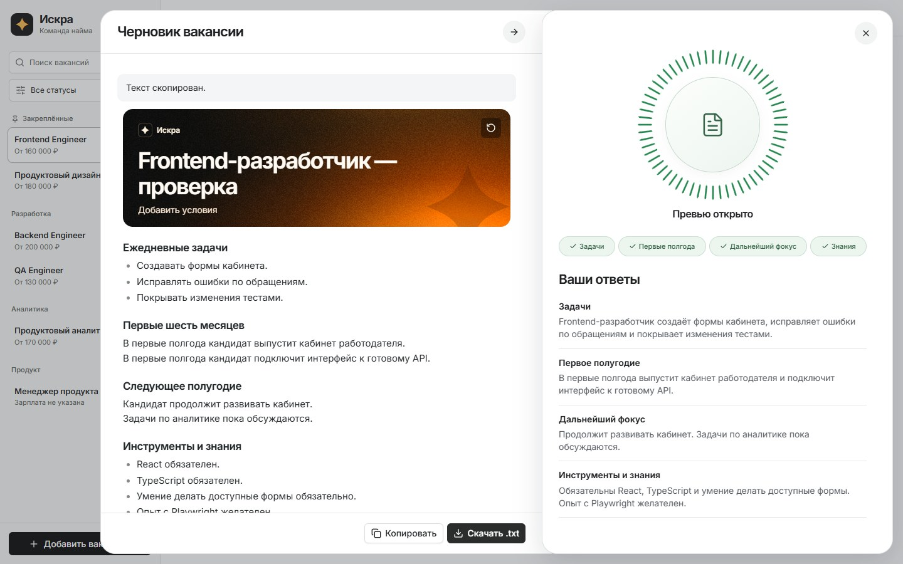

# Искра — создание вакансии

Прототип помогает руководителю описать будущего сотрудника за четыре вопроса и получить редактируемую вакансию. Я сделал его как новый сценарий внутри кабинета «Искры».

**[Открыть прототип](https://amo0orkie.ru/iskra/)** · [Что сделано и как работал](docs/delivery/submission.md)



## Как попробовать

1. В кабинете нажимаю «Добавить вакансию».
2. Отвечаю на четыре вопроса — про задачи, первые полгода, дальнейшие планы и знания. Записываю ответ с микрофона или ввожу текст.
3. Подтверждаю каждый ответ на круге. Кольцо заполняется на четверть, у темы появляется галочка.
4. После подтверждения четвёртого ответа слева автоматически открывается превью и начинает собираться вакансия.
5. Правлю текст прямо в превью, копирую его или скачиваю .txt.

## Что работает

- Кабинет на shadcn/ui с тестовыми вакансиями, кандидатами, поиском, фильтром статусов и аналитикой.
- Интервью с четырьмя темами, редактированием ответов и круговым прогрессом по референсу Face ID.
- Настоящий микрофон, реакция кнопки на громкость, серверное распознавание русской речи и проверка тишины.
- Автоматическая генерация через DeepSeek, ожидание и отмена, редактирование результата, копирование и скачивание.
- Настольная и мобильная версии. Отмена выхода и предупреждение перед заменой ручных правок.

В публичной версии запрашивается разрешение на микрофон. Аудио распознаётся на сервере через faster-whisper, без отправки аудио стороннему API. Тишина оставляет ответ пустым. Ответы живут в текущей вкладке. Сохранение вакансии в рабочей «Искре» остаётся отдельной интеграцией.

## Как подключён ИИ

В опубликованной версии используется `ds/deepseek-v4.1-flash` через мой шлюз WikiVibe API. После завершения четвёртой темы сервер отправляет четыре подтверждённых ответа, проверяет JSON и дословные цитаты, затем показывает вакансию.

Ключ хранится на сервере. Браузер обращается к backend приложения. При ошибке сохраняются ответы и предыдущая редакция. Настроен общий предел в 20 API-попыток с постоянным счётчиком. [Подробности подключения](docs/technical/owner-api.md).

## Как устроены документы

Основа разработки — спека. Из неё я вывожу план, затем задачи для PR.

| Что посмотреть | Где |
| --- | --- |
| Задание | [Исходное ТЗ](docs/product/brief.md) |
| Аналоги и референсы | [Исследование решений](docs/research/competitive-review.md), [исследование «Искры»](docs/research/iskra-live-ui-2026-11-10.md) |
| Зачем и как пользоваться | [JTBD](docs/product/jtbd.md), [user-flow](docs/product/user-flow.md) |
| Что требуется от текущей функции | [Спека F005](docs/specs/005-iskra-workspace/spec.md) |
| Как это реализовано | [План](docs/specs/005-iskra-workspace/plan.md), [задачи](docs/specs/005-iskra-workspace/tasks.md) |
| Промпты приложения | [Генерация и проверка ответов](src/server/prompts.ts) |
| Работа с Codex | [Журнал процесса](docs/process/ai-worklog.md) |
| Публичная проверка и выкладка | [Отчёт](docs/verification/007-real-voice.md), [размещение и откат](docs/technical/deployment.md) |

Полная навигация находится в [docs](docs/README.md).

## Локальный запуск

Нужен Node.js **26.13.0**. В корне проекта запускаю:

```sh
npm ci
npm run build
npm start
```

Открываю http://127.0.0.1:4317/. По умолчанию доступны готовые примеры. Чтобы подключить генерацию, копирую `.env.example` в `.env`, задаю ключ, модель и `AI_ENABLED=true`. Файл `.env` исключён из Git.

Для разработки запускаю `npm run dev` и `npm run dev:server` в двух терминалах. Интерфейс открывается на http://127.0.0.1:4316/.

## Проверки

```sh
npm run check
npx playwright install chromium
npm run test:e2e
python scripts/check_docs.py
```

Перед выкладкой прошли проверка типов, сборка, 41 тест и 54 браузерных прогона Chrome/Edge. Публичный сценарий с настоящей генерацией, редактированием и экспортом проверен отдельно. [Результаты](docs/verification/007-real-voice.md).
