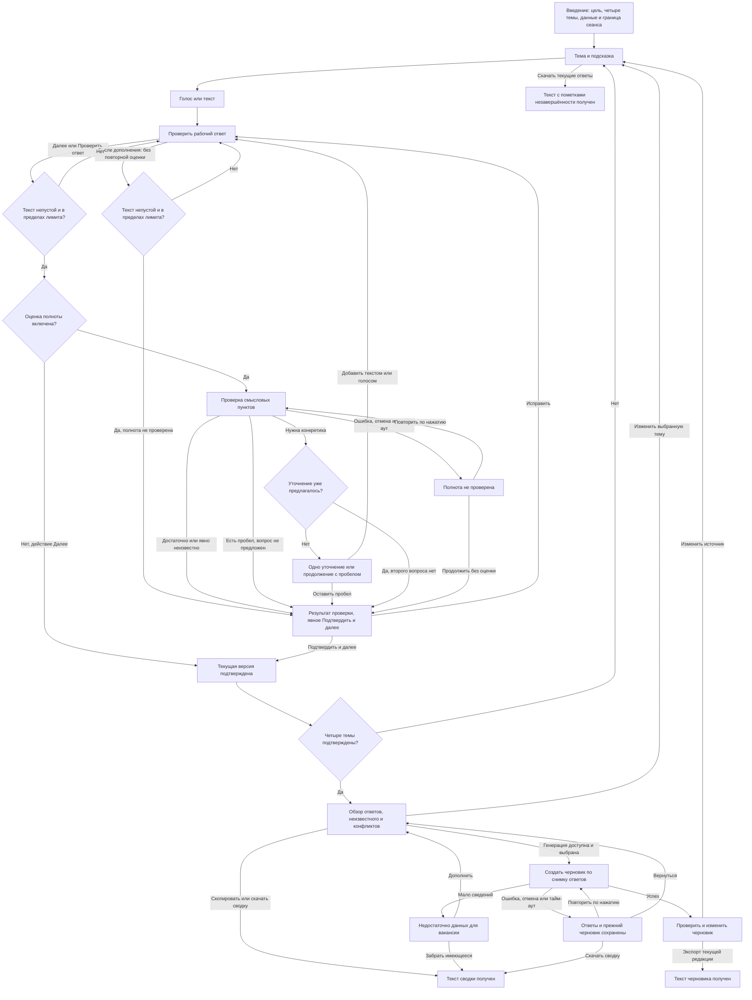

# Пользовательский сценарий

Дата: 10.11.2026. Статус: поведение принято в [product-v1](accepted-decisions-2026-11-10.md); тестовый UI реализован и проверен в [отдельном срезе](../verification/003-voice-interview-ui.md). Пользовательских тестов и полной интеграции нет. Основания: [J1–J8](jtbd.md), [brief](brief.md), [исследование](../research/competitive-review.md).

Я описываю путь от первого ответа до проверяемого описания вакансии. Сводка даёт промежуточный и запасной выход. В полной цели генерация должна работать; пользователь может выбрать сводку без неё. Обработку ошибок и сохранность считаю частью этого пути.

## Вход, выход и уровни результата

Продуктовый контекст — создание вакансии внутри «Искры». Предполагаемый вход через «Добавить вакансию», возврат и сохранение черновика описаны отдельно в [предложении по встраиванию](iskra-context.md). Реальный переход кнопки не проверен, API сохранения не получен. Основной путь ниже описывает само интервью; его текущая демонстрация запускается отдельно от «Искры».

Вход: руководитель открывает пустое интервью о будущей роли. Введение объясняет четыре темы, голос/текст, фактическую обработку аудио и отсутствие восстановления после закрытия/перезагрузки. Русский язык — рабочее предположение. Регистрация, публикация и отправка рекрутеру вне прототипа.

| Уровень | Полезный выход | Ограничение |
| --- | --- | --- |
| Базовый | Сводка проверенных ответов, копирование и скачивание без генератора | Сводка не является сгенерированной вакансией; без настоящего голоса BR-02 ещё не выполнено |
| С оценкой полноты | Та же сводка с понятными смысловыми пробелами | Не оценка качества сотрудника или вероятности успешного найма |
| С генерацией | Редактируемый черновик с неизвестным и источниками фактов | Ещё не согласован рекрутером и не опубликован |
| Прерванный/неполный сеанс | Экспорт имеющегося текста с пометками незавершённости | Не считается выполнением основной работы J1 |

Сводка не зависит от оценки или генерации. Человек самостоятельно передаёт полученный файл или текст. Скачивание частичных данных не подтверждает их пригодность для найма.

## Основной путь и выходы

Ответ ИИ сам не подтверждает тему. В F003 я разделяю действия: сначала «Проверить ответ», затем явное «Подтвердить и далее». После дополнения можно отказаться от повторной оценки и подтвердить допустимый текст с пометкой отсутствия оценки. Без F003 достаточно «Далее» после проверки допустимости текста. После подтверждения открывается первая ещё не подтверждённая тема, после четырёх — обзор. Возврат открывает выбранную тему с её текстом, не новое интервью.

Уточнение предлагается максимум один раз на тему. Предложение считается использованным и при отказе дополнять; возврат к теме не сбрасывает квоту. Повторная оценка допустима, второй вопрос — нет. Оставшиеся пробелы видны перед подтверждением. Сетевые повторы ручные и не создают новую квоту уточнений.

После уточнения я предлагаю «Дополнить ответ» голосом или текстом. Дополнение сначала видно отдельно; «Добавить к ответу» присоединяет его с новой строки к существующему тексту. Основной ответ не заменяется. Человек видит объединённый текст, может исправить его и снова проверить либо подтвердить с пометкой «Полнота не проверена». Отмена дополнения сохраняет прежний ответ. Для обычной перезаписи отдельно существует явная замена.

## Четыре темы и неизвестность

| Тема | Предлагаемый вопрос | Полезные сведения | Допустимое неизвестное |
| --- | --- | --- | --- |
| Q1 | Какие две-три задачи сотрудник будет выполнять каждый день? | Действия и ожидаемые результаты | Пока известна одна задача; остальные нужно определить |
| Q2 | Над каким проектом сотрудник будет работать первые шесть месяцев? | Контекст и вклад роли | Проект ещё не определён |
| Q3 | Что изменится в следующие полгода: продолжение проекта или другой фокус? | Продолжение, переход или отсутствие изменений | План пока неизвестен |
| Q4 | Какие инструменты и знания нужны для этих задач? Что обязательно, а что желательно? | Связь навыка с работой и обязательность | Инструмент не принципиален; часть требований ещё не определена |

Пустота и пробелы не являются ответом. Явное «пока не знаю» можно сказать или написать и подтвердить в любой теме. Оно остаётся неизвестным и не становится конкретным фактом из-за подтверждения. Придумывать сведения ради перехода не требуется.

При неразрешённых противоречиях не выбирается автоматически последняя реплика. Но явное исправление «поправлюсь: SQL желателен, не обязателен» отменяет прежнее утверждение об обязательности. Работа над одним проектом в первом полугодии и другим во втором — последовательность, а не конфликт. Если непонятно, что именно отменено, сохраняю оба фрагмента и вопрос. Без оценки/генерации автоматическое обнаружение конфликтов не обещается; человек проверяет сводку сам.

Если все ответы явно неизвестны либо генератор не может построить текст без домыслов, результат — недостаточность материала с путями дополнения и экспорта сводки. Это не готовая вакансия. При частичной неизвестности допустим черновик с известными задачами и явными вопросами, без придуманной зарплаты, уровня или локации.

Название роли используется только если явно указано в ответах; иначе показана необходимость уточнения. Отдельной обязательной анкеты с названием, зарплатой и условиями нет. Если человек сам сообщил условия, я сохраняю их в разделе «Роль и известные условия». Формулировки вопросов, результат задачи и обязательность навыков — принятые решения product-v1; нехватка этих дополнительных деталей не запрещает подтвердить ответ.

## Состояния, действия и восстановление

| Состояние | Действия и следующий шаг | Что сохраняется |
| --- | --- | --- |
| Введение | Начать; понять ограничение сеанса до ввода | Пустой сеанс |
| Ожидание разрешения | Отменить ожидание, перейти к тексту | Рабочий и подтверждённый текст |
| Микрофон недоступен | Текст либо повтор по нажатию после настройки | Все ответы |
| Запись | Остановить для расшифровки либо отменить | Существующий текст не удаляется |
| Вкладка скрыта во время записи | Запись остановлена без отправки; после возврата — расшифровать, перезаписать или удалить | Временное аудио и существующий текст |
| Устройство прервалось | Не отправлять неполное аудио автоматически; новая запись или текст | Существующий текст |
| Расшифровка | Отменить; при ошибке — повторить пока аудио доступно, перезаписать или ввести текст | Прежний текст и временное аудио текущей темы |
| Получен новый текст | Если редактор пуст — проверить; если текст уже есть — явно выбрать замену или отказ | Прежний текст до согласия на замену |
| Редактирование | Подтвердить, отменить изменения, вернуться к теме | Рабочая и последняя подтверждённая версии |
| Оценка/уточнение | Дополнить либо продолжить с пробелом; при ошибке — повтор или без оценки | Текст и использованная квота уточнения |
| Обзор | Изменить тему, экспортировать сводку, опционально генерировать | Все версии и пробелы |
| Генерация | Отменить; при ошибке — повтор, обзор или сводка | Ответы, предыдущий результат и ручные правки |
| Недостаточно данных | Дополнить ответы или забрать неполную сводку | Уже введённый материал |
| Результат | Изменить, экспортировать, вернуться к источнику | Текущая редакция и исходный сгенерированный вариант |
| Ошибка копирования | Выделить вручную или скачать текст | Текущий результат |
| Полный сброс | Подтвердить удаление либо отменить | Отмена сохраняет весь сеанс |

После обычной остановки начинается расшифровка; это объясняется до записи рядом с действием. После скрытия вкладки отправка требует явного нажатия. Камера не запрашивается. Лимиты, тайм-ауты и фактические условия внешней обработки фиксируются в спецификации до интеграции; разрешение браузера не заменяет эту информацию.

## Рабочая версия и сохранность

1. У темы есть рабочий текст и последняя подтверждённая версия. Навигация в открытой вкладке сохраняет оба. Открытие редактора без изменения текста не отменяет подтверждение.
2. Изменение текста снимает подтверждение до следующего явного действия. «Отменить изменения» возвращает прежние текст и статус. Другие темы не меняются.
3. Повторная запись не удаляет текст. Новый результат заменяет его только после выбора человека; отмена или ошибка сохраняет прежнюю версию.
4. Смена темы/способа ввода прекращает активную запись и отменяет её запрос. Если переход удалит незавершённое аудио, человек выбирает «Остаться» или «Перейти и удалить запись». Текст при обычной навигации не теряется и не требует такого подтверждения.
5. Позднее разрешение после отмены не начинает запись; stream освобождается. Поздние расшифровка и оценка принимаются только для своей темы, версии и активного запроса. Ручная правка во время запроса не перезаписывается.
6. Аудио временное: после успешной расшифровки, отмены, подтверждённой замены/удаления, перехода к другой теме и сброса оно удаляется из памяти приложения. При уходе со страницы микрофон освобождается. После ошибки аудио доступно для ручного повтора только в текущей теме до одного из этих действий.
7. Закрытие/перезагрузка уничтожает сеанс. Нельзя обещать обязательное браузерное предупреждение или восстановление. «Скачать текущие ответы» сохраняет текст с пометками неизвестных/неподтверждённых тем, без аудио; полностью пустой сеанс не выдаётся за полезный результат.
8. Сброс требует подтверждения удаления ответов и редакции черновика. Отмена ничего не удаляет.

## Генерация, правки и актуальность

Генератор получает снимок четырёх подтверждённых версий. Если источник изменился во время запроса, результат старого снимка не заменяет новую работу. Отмена и сбой сохраняют ответы и прежний результат; повтор запускает человек.

При изменении рабочего ответа черновик помечается устаревшим, без автоматической перегенерации. Отмена изменения до исходного подтверждённого снимка восстанавливает актуальность; новые подтверждённые сведения требуют новой генерации. Отменённый запрос сам не возобновляется.

Ручная редакция хранится отдельно от исходного варианта в текущем сеансе. Перед её заменой новой генерацией требуется явное подтверждение. Отмена, сбой или поздний ответ не уничтожают правки. Ручные изменения отмечаются; старые ссылки на источник не подтверждают новый текст автоматически.

Экспорт включает текущую редакцию и список неизвестного/конфликтов. Устаревший черновик экспортируется с видимой пометкой, которая остаётся в самом тексте. Сводка и черновик имеют разные названия. Неподтверждённые ответы допустимы только в экспорте текущих ответов с соответствующей пометкой, не во входе генератора.

## Прогресс и содержательная готовность

Уточнённое A10 принято в [product-v1](accepted-decisions-2026-11-10.md): кольцо всегда показывает общий прогресс интервью, независимо от наличия F003.

| Показатель | Что он означает | При правке и ожидании |
| --- | --- | --- |
| Круговой прогресс | «Подтверждено N из 4 тем», одна тема даёт четверть | Правка снимает четверть до подтверждения; отмена правки восстанавливает её. Запись, обработка и навигация сами заполнение не меняют |
| Полнота текущего ответа | «Есть сведения: N из M; явно неизвестно: K» | После правки прежний балл убирается. Ожидание и ошибка не получают выдуманной оценки |

После подтверждения сегменты плавно окрашиваются по часовой стрелке. На следующей теме значение сохраняется; после четвёртой кольцо заполнено на 100% и открывается обзор. При reduced motion тот же прогресс показан сразу, без пульсации и задержек. Во время записи отдельная реакция кнопки и таймер показывают состояние записи, не полноту ответа.

Позиция темы видна в верхнем маршруте. Подтверждённое «не знаю» завершает тему и заполняет четверть, но не превращает неизвестное в конкретику. Полное кольцо означает завершённое интервью, а не готовность вакансии к публикации.

## Что видно на основном экране

Показываю один вопрос, краткую подсказку, круг с подписью, ввод и главное действие текущего этапа. После остановки — понятное ожидание и проверяемый текст, после проверки — короткий пробел или подтверждение. Подробности источников, правила оценки и данные раскрываются по запросу. Идентификаторы, версии, названия статусов API и внутренний пайплайн не появляются в основном пути. Переход не скрывает ошибку, не уносит фокус и не блокирует возможность отмены. Это проверю отдельно от самих формул прогресса.

## Доступность и проверка

Весь путь, включая отказ от голоса, восстановление и экспорт, доступен клавиатурой. После смены темы фокус получает её заголовок; закрытие диалога возвращает его вызвавшему действию. Состояния и ошибки различимы без цвета/анимации. Reduced motion сохраняет подписи и значения без декоративных движений. Проверки screen reader и браузеров относятся к приёмке реализации.

Ориентир по шагам, прогрессу и сохранению ввода при возвратах — [W3C WAI: Multi-page Forms](https://www.w3.org/WAI/tutorials/forms/multi-page/), проверен 10.11.2026. Ограничения микрофона: [scope-and-decisions.md](scope-and-decisions.md). Контрольные пути: [scenario-cases.md](scenario-cases.md).
