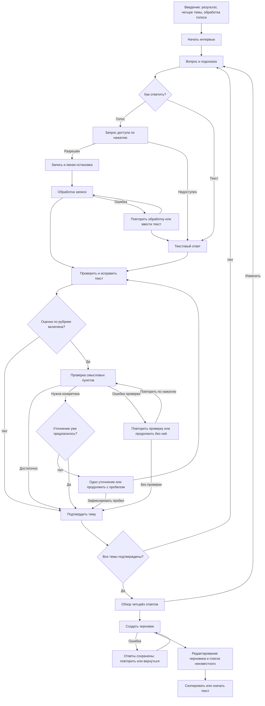

# Пользовательский сценарий

Дата: 10.11.2026. Статус: предложение для согласования; не результат пользовательского тестирования. Основания: [J1–J6](jtbd.md) и [исследование](../research/competitive-review.md).

## Границы сценария

Вход: руководитель открывает прототип с пустым интервью. Выход: проверенный пользователем черновик можно скопировать или скачать текстом. Регистрация, публикация вакансии и ATS не входят в сценарий. Интерфейс и ответы первого прототипа предлагаются на русском.

## Основной путь

Уточнение доступно максимум один раз на тему. При дополнении после уточнения повторный переход к U запрещён: проверка показывает результат и даёт подтвердить тему с явным пробелом. Ошибка проверки полноты также не запускает бесконечный цикл.

## Содержание четырёх тем

| Тема | Предлагаемый вопрос | Что желательно узнать | Допустимый пробел |
| --- | --- | --- | --- |
| Q1 | Какие две-три задачи сотрудник будет выполнять каждый день? | Конкретные действия и ожидаемые результаты | Пока известна только одна задача |
| Q2 | Над каким проектом сотрудник будет работать первые шесть месяцев? | Контекст проекта и вклад роли | Проект ещё не определён |
| Q3 | Что изменится в следующие полгода: продолжение проекта или другой фокус? | Продолжение, переход или явная неопределённость | План пока неизвестен — это полноценный ответ |
| Q4 | Какие инструменты и знания действительно нужны для этих задач? | Связь навыка или инструмента с работой | Инструмент не принципиален, важен результат |

Это предлагаемые уточнения языка исходного brief, а не утверждённые заказчиком формулировки. Название роли допускается уточнить в обзорном экране; отсутствие названия не разрешает модели его выдумывать.

## Состояния и восстановление

| Состояние | Что видно | Доступное действие | Что сохраняется |
| --- | --- | --- | --- |
| Введение | Цель, четыре темы, информация об обработке | Начать | Пустое интервью |
| Ожидание разрешения | Запрос в браузере и текстовый путь | Отказаться от ожидания, ответить текстом | Уже введённые ответы |
| Микрофон запрещён/отсутствует | Понятная причина без обвинения пользователя | Текст, инструкция по разрешению, повтор по нажатию | Текст и подтверждённые темы |
| Запись | Индикатор записи, таймер и кнопка остановки | Остановить, отменить | Ранее подтверждённый ответ не заменяется до подтверждения нового |
| Обработка | Неопределённое ожидание без выдуманного процента | Отмена, текстовый путь | Запись временно в текущей сессии |
| Редактирование | Расшифровка с вопросом рядом | Исправить, записать заново, подтвердить | Последний подтверждённый ответ до замены |
| Уточнение | Конкретный пробел и один дополнительный вопрос | Дополнить либо продолжить с пробелом | Текущий текст |
| Обзор | Четыре ответа, отмеченные пробелы | Вернуться к любой теме, генерировать | Подтверждённые версии |
| Генерация | Ожидание и возможность отмены | Отменить или повторить после ошибки | Все ответы и предыдущий черновик |
| Результат | Редактируемые разделы и неизвестные сведения | Изменить, скопировать, скачать | Черновик текущей сессии |
| Ошибка копирования | Текст остаётся доступным | Выделить вручную, скачать | Черновик |

## Правила прогресса

В минимальном уровне кольцо показывает подтверждённые темы: 0/4, 1/4, 2/4, 3/4, 4/4. Пояснение: «Ответы подтверждены: N из 4». Оно не заполняется от времени записи и не называется оценкой качества. До подтверждения текущего ответа значение не меняется.

В среднем уровне предлагается отдельное отображение покрытых смысловых пунктов текущей темы. Нужно явно объяснить шкалу и неизвестность. Одно кольцо не переключает смысл незаметно. При редактировании подтверждённой темы она возвращается в непроверенное состояние до повторного подтверждения; итоговый черновик отмечается как устаревший.

## Доступность и управление

- Запись начинается только по действию пользователя; камера не запрашивается.
- Весь основной сценарий доступен клавиатурой; после смены вопроса фокус перемещается к его заголовку.
- Цвет и анимация дополняют подпись состояния, но не заменяют её.
- При reduced motion декоративная анимация отключается, численный прогресс сохраняется.
- При уходе со страницы запись прекращается. Обещания восстановления после перезагрузки нет до решения о хранении; потеря текущей сессии объясняется заранее.
- Лимиты записи и тайм-ауты должны быть определены в спецификации до реализации, а не скрыты в коде.

Технические основания доступности и браузерных ограничений: [scope-and-decisions.md](scope-and-decisions.md).
