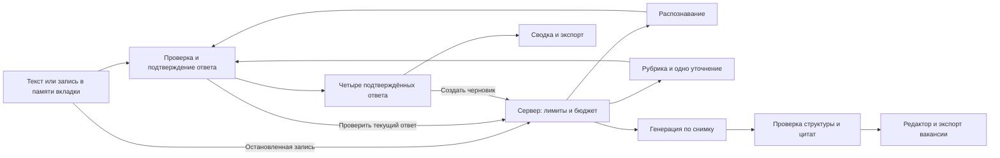

# Технический план первой версии

Дата проверки источников: 10.11.2026. Версия: tech-v2. Статус: выбранный подход до реализации.

Я реализую принятую [product-v1](../product/accepted-decisions-2026-11-10.md) небольшими PR. Начинаю с локального текстового сценария, затем добавляю запись, защищённый сервер и настоящие AI-функции. API по умолчанию выключен. Границы реализуемого тестового среза и его проверки отмечены отдельно.

## Мой выбор

| Часть | Решение | Почему и какой компромисс |
| --- | --- | --- |
| Интерфейс | React + TypeScript + Vite; обычный CSS и SVG-кольцо | Один сценарий без SEO, серверного HTML и сложной навигации. Не нужны Next.js, UI-конструктор или отдельная библиотека анимации |
| Состояние | Один reducer сеанса и отдельные контроллеры записи/запросов | Переходы и поздние ответы проверяются независимо от экрана. Redux и хранилище истории пока не нужны |
| Сервер | Один Node.js-процесс с Fastify; раздаёт собранный интерфейс и `/api/*` с одного origin | Ключ, проверка входа и расходы находятся на сервере. Один процесс проще поддерживать; горизонтальное масштабирование вне первой версии |
| Контракты | Zod, JSON Schema для ответа модели, версии схем/промптов в Git | Формат проверяется автоматически; смысл и сохранность фактов требуют отдельного набора примеров |
| Распознавание | Мой API; пока локальная имитация на тестовых данных | Протокол и поддержку аудио уточню перед интеграцией; прямого подключения сейчас нет |
| Проверка/генерация | Мой API; в этом срезе детерминированный тестовый адаптер | Протокол не считаю совместимым с OpenAI. Тестовые ответы не доказывают качество модели |
| Данные | Сеанс в памяти вкладки; без БД, аккаунтов и object storage | Перезагрузка теряет работу — предупреждение и экспорт обязательны |
| Проверки | Vitest, Fastify inject, Playwright; настоящие Chrome/Edge и микрофон отдельно | Фикстуры проверяют интерфейс и ошибки, но не подтверждают русский ASR и качество модели |
| Размещение | Сначала localhost; для будущего демо Render, один платный Web Service `0.5c-512mb` и диск 1 GB | Один origin, HTTPS и постоянный счётчик расходов. Стоимость около $7,25/месяц до доплат. Подключение и деплой ещё не разрешены |

Новое решение и границы этого PR — в [плане тестового прототипа](mock-prototype.md). Старое сравнение OpenAI в [бюджете](services-and-budget.md) оставлено как история и к моему API не применяется. Обработка данных и границы API — в [контракте](data-and-api.md). Конкретная очередь — в [задачах](tasks.md).

## Версии и зависимости

Я выбираю Node.js 26 LTS. На этой машине сейчас Node 22.20.0; окружение ещё не обновлялось. Стабильный последний patch Node 26 закреплю в PR каркаса и CI. Версии ниже прочитаны из официального npm registry 10.11.2026; это кандидаты для lockfile, установка и совместная сборка пока не проверены.

| Пакет | Версия |
| --- | --- |
| react | 19.3.1 |
| vite | 8.3.7 |
| typescript | 7.0.2 |
| fastify | 5.12.8 |
| @fastify/multipart | 10.1.8 |
| @fastify/static | 10.1.10 |
| zod | 4.6.7 |
| vitest | 5.1.0 |
| @playwright/test | 1.65.0 |
| openai | Не устанавливаю: выбран мой API |
| tsx | 4.23.15 |

Перед установкой сверяю peerDependencies, поддержку Fastify плагинами и react-dom той же версии. Не ставлю плагины только потому, что у них тег latest. Если выбранная версия несовместима, фиксирую ближайшую поддерживаемую и причину в PR. Один npm lockfile, `npm ci` в CI, без глобальных библиотек приложения.

Основания: [Node LTS](https://nodejs.org/en/about/previous-releases), [Vite](https://vite.dev/guide/), [React](https://react.dev/learn/build-a-react-app-from-scratch), [Fastify LTS](https://fastify.dev/docs/latest/Reference/LTS/). Версии пакетов: `https://registry.npmjs.org/<package>/latest`. Сами версии не доказывают работоспособность комбинации.

## Структура кода

```text
src/client/           экраны, доступность, экспорт, контроллер микрофона
src/domain/           reducer, версии ответов, снимки, чистые правила
src/contracts/        вход/выход API, лимиты, версия рубрики
src/server/           маршруты, валидация, тайм-ауты, бюджет, адаптер моего API
prompts/              completeness-v1, vacancy-v1; без пользовательских данных
tests/fixtures/       вымышленные ответы и ответы сервисов
tests/e2e/            браузерные сценарии
docs/verification/    фактические результаты на commit SHA
```

Эта структура реализуется в первом тестовом срезе; настоящие интеграции ещё отсутствуют. Я не добавляю роутер, агентный фреймворк, очередь, Redis, БД, аналитику с записью сессий или чат. Общие чистые правила доступны клиенту и серверу; ключи и адаптер провайдера никогда не импортируются в клиентскую сборку.

## Поток данных



Клиент повторно проверяет `sessionId/requestId/revision` либо `snapshotId/draftEditRevision` перед применением результата. Abort прекращает ожидание, но не даёт обещания отменить стоимость уже отправленного запроса. Сервер не доверяет версии, бюджету, MIME и размеру, переданным браузером.

## Экран и доступность

Сначала делаю один экран: вопрос, подсказка, кольцо с текстовой подписью, редактор и основное действие. Проверяю пустое состояние, запись, остановку, ожидание, предложение расшифровки, ошибку и заполненный ответ. Затем распространяю решение на остальные темы и итог. Светлый фон, нейтральный текст, один акцент; без копирования закрытых активов Apple.

Фокус и клавиатура следуют сценарию. Заполненность и смысловое покрытие имеют текстовые значения; SVG декоративен, значение продублировано доступным `meter`. Ожидание — отдельный status, без ложного процента. Аудиоактивность не увеличивает смысловую полноту. Reduced motion отключает декоративное движение. Размеры 360, 768 и 1440 px проверю в браузере; поддержка узкой вёрстки не означает приёмку мобильного микрофона.

## Порядок и границы PR

1. Документы: принятие в PR 1/2; этот план отдельным PR поверх спек.
2. Каркас, контракты и первый экран без платного провайдера.
3. F001: рабочий текстовый сценарий и экспорт.
4. F002: запись и безопасные остановки; сервер и ограничения; затем настоящая транскрибация после проверки подключения.
5. F003: рубрика, проверка, одно уточнение и кольцо.
6. F004: генерация, источники, редактор и экспорт.
7. Полный проход и комплект сдачи. Деплой — отдельное действие после решения владельца.

До подключения можно выполнять все задачи с явно обозначенными фикстурами. Они не закрывают критерии настоящего AI. Если сервис недоступен или не проходит качество, я сохраняю рабочий текстовый сценарий, обновляю выбор и бюджет до переключения. Автоматического fallback к другому провайдеру нет: он неожиданно менял бы получателя данных и стоимость.

## Условия готовности

У каждого PR есть требования/критерии из [карты покрытия](../specs/coverage.md), команды проверок и `verification.md` с SHA. Для интеграций фиксирую модель, версии промпта/рубрики, браузер, задержки и стоимость. До объявления полной цели готовой нужны SC01–SC40, все 103 критерия, реальные русские записи, проверка сохранности фактов и комплект BR-07–BR-10. Непройденные проверки остаются открытыми.

Срок сдачи не задан. План задаёт зависимости и границы, а не обещанный календарь. Изменения требований сначала проходят через спецификации.
