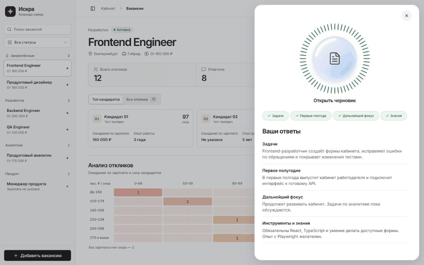

# Интервью и черновик в кабинете Искры

Для второго PR по [спеке F005](../specs/005-iskra-workspace/spec.md) я беру задачи T05–T11. Из кабинета сразу попадаю на первый вопрос. После каждого подтверждения заполняется четверть кольца. На четвёртом ответе справа появляется обзор. По кнопке «Создать черновик» открываю превью, редактирую его и могу вернуться к своим ответам.

[Интервью на широком экране](iskra-panels/interview.jpg) · [Обе панели](iskra-panels/preview.jpg) · [Превью на телефоне](iskra-panels/mobile.jpg)

## Что показали проверки

- На окне 1440 × 900 Playwright измерял координаты и размеры интервью до нажатия и на каждом доступном кадре до окончания перехода. При открытии и закрытии правая панель оставалась в точке (864, 16), размер 560 × 868. Левый край превью прошёл от 880 до 160 пикселей и обратно. Проверка прошла в Chrome и Edge.
- При трёх подтверждениях создание недоступно. Четвёртое открывает обзор, а двойное нажатие на создание запускает одну сборку. Ожидающее превью можно закрыть и запустить заново. Готовая редакция открывается из памяти.
- Новый фрагмент демо-записи можно добавить или подставить вместо прежнего текста. Проверка полноты сохраняет счётчик тем. Поле принимает 6000 символов Unicode и показывает превышение на 6001, сохраняя введённый текст.
- Правка подтверждённого ответа снимает галочку. Отмена возвращает её. В готовом черновике видно устаревание, а перед заменой ручной редакции появляется подтверждение. В выгруженном файле проверен изменённый текст.
- При ошибке, тайм-ауте, нехватке сведений и произвольном тексте ответы доступны для исправления и выгрузки. Отдельные тесты проверяют явную неизвестность и противоречие в требованиях к Playwright.
- В Яндекс Браузере полный путь выполнен на тестовых данных. На ширине 1200, 1280 и 1440 пикселей видны обе панели. На 1199, 1024, 390 и 360 видна одна. Горизонтальная прокрутка страницы не появилась. Правка сохранилась после закрытия и повторного открытия превью. За весь проход браузер не отправил запросов к API или внешним адресам.
- В мобильном режиме с уменьшенным движением проверены клавиатурный возврат, фокус и оба слоя с axe. Для правил WCAG A/AA из используемого набора нарушений не найдено.

## Как повторить

Запускаю проект по [инструкции](../../README.md), открываю кабинет и нажимаю «Добавить вакансию». Для положительного сценария четыре раза нажимаю «Вставить пример» и «Подтвердить ответ». В обзоре нажимаю «Создать черновик». Возврат стрелкой или Escape закрывает превью. Чтобы получить сбой, перед сборкой выбираю его в «Параметрах демо».

`npm run check` выполнил проверку типов, 37 тестов и сборку. `npm run test:e2e` с `TEST_BROWSER=chrome,msedge` прошёл в обоих браузерах. Всего 46 успешных прогонов, по 23 на каждый браузер. Покадровый замер и проверки возврата лежат в [браузерном тесте](../../tests/e2e/iskra-panels.spec.ts).

Запись, распознавание и генерация в кабинете работают на примерах. Настоящий микрофон и внешний API относятся к отдельным интеграциям. Изменение кнопки в ответ на уровень звука и проверка диктором остаются в следующем этапе плана.
